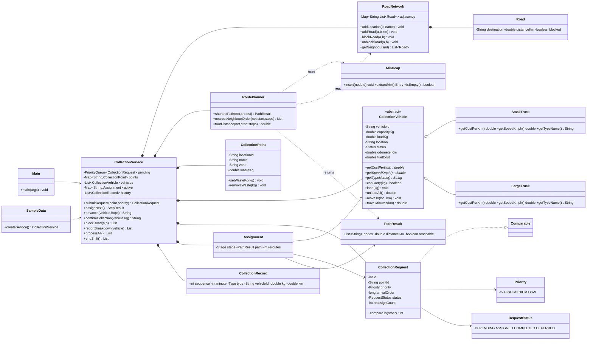

# Smart City Waste Collection Optimization — Marudham Municipality

A console application in plain Java (no libraries, no database, no frontend, no sensors, no external APIs) that
schedules and routes waste-collection trucks for the fictional municipality of **Marudham**.
It uses OOP, Java Collections, a weighted adjacency-list graph, and a hand-written **min-heap + Dijkstra**.

> **Honesty note on optimisation.** Dijkstra gives the *shortest path between two locations* on the roads that are currently open.
> The overall schedule (priority-first queue + cheapest-available-vehicle choice) is a **greedy heuristic**. It is **not**
> claimed to be globally optimal. See [Algorithms](#6-algorithms) and [Limitations](#13-limitations).

---

## 1. What was actually executed (verification status)

| Item | Status |
|---|---|
| Compile all sources with `-Xlint:all` | **Executed**, 0 errors, 0 warnings (Java 21.0.10) |
| `java marudham.Main demo` (scripted walkthrough) | **Executed**, output in `demo_output.txt` |
| Interactive menu driven by piped input (`sample_session_input.txt`) | **Executed**, output in `sample_session_output.txt` |
| `TestRunner` — 10 scenarios, **118 checks** | **Executed: 118 passed, 0 failed** (`test_output.txt`) |
| Mutation sanity check of the tests (6 deliberate bugs injected into a temp copy) | **Executed: all 6 mutants made tests fail** (tie-break reversed, Dijkstra ignoring blocked roads, capacity check removed, breakdown reassignment removed, priority order inverted, depot unloading removed) |
| `compile.sh`, `run.sh`, `test.sh`, `*.bat` wrappers | **Not executed as written.** The sandbox had a JRE with the `jdk.compiler` module but no `javac` launcher, so I compiled with the equivalent `java -m jdk.compiler/com.sun.tools.javac.Main …`. The scripts contain the same commands with `javac`. The `.bat` files were never run on Windows. |
| Compatibility with Java versions other than 21 | **Not tested.** Code avoids records / `var` / switch expressions / text blocks, so Java 11+ is expected to work, but only 21 was used. |
| Interaction by a human at a real terminal | **Not done**; the menu was driven by piped stdin. |

The five required test scenarios (normal operation, full vehicle, blocked road, equal priorities, vehicle breakdown) are T1–T5; T6–T10 are extra.

---

## 2. Project layout

```
MarudhamWaste/
├── src/marudham/
│   ├── CollectionPoint.java     waste collection point (encapsulation)
│   ├── CollectionVehicle.java   ABSTRACT base class for trucks
│   ├── SmallTruck.java          subclass: 6/km, 30 km/h
│   ├── LargeTruck.java          subclass: 14/km, 25 km/h
│   ├── CollectionRequest.java   request, Comparable (priority, arrival order)
│   ├── RoadNetwork.java         weighted adjacency-list graph (HashMap + ArrayList)
│   ├── CollectionRecord.java    one history / audit entry
│   ├── RoutePlanner.java        Dijkstra + greedy nearest-neighbour analysis helper
│   ├── CollectionService.java   orchestration: queue, assignment, rerouting, breakdowns, reports
│   ├── Main.java                interactive menu (+ "demo" mode)
│   │   ── supporting files ──
│   ├── MinHeap.java             separate array-based binary min-heap used only by Dijkstra
│   ├── PathResult.java          immutable path + distance
│   ├── Assignment.java          one vehicle's current job and remaining route
│   ├── Priority.java            enum HIGH / MEDIUM / LOW
│   ├── RequestStatus.java       enum PENDING / ASSIGNED / COMPLETED / DEFERRED
│   └── SampleData.java          the Marudham map, points, fleet, 17 sample requests
├── test/marudham/TestRunner.java   dependency-free tests (no JUnit needed)
├── compile.sh run.sh test.sh   (+ .bat versions)
├── demo_output.txt  test_output.txt  sample_session_input.txt  sample_session_output.txt
└── README.md
```
The ten classes you asked for are all present as separate files; the extra files are small helpers.

---

## 3. Compile and run

Requires a JDK (not just a JRE).

**Linux / macOS**
```sh
./compile.sh          # javac -d out src/marudham/*.java  and compiles tests
./run.sh              # interactive menu
./run.sh demo         # scripted end-to-end walkthrough
./test.sh             # run all tests (exit code 0 = all passed)
```
**Windows:** `compile.bat`, `run.bat`, `run.bat demo`, `test.bat`.

**By hand**
```sh
mkdir out out-test
javac -d out src/marudham/*.java
javac -cp out -d out-test test/marudham/TestRunner.java
java -cp out marudham.Main            # or: java -cp out marudham.Main demo
java -cp out:out-test marudham.TestRunner      # on Windows use ; instead of :
```
If only a JRE-with-compiler-module is available: `java -m jdk.compiler/com.sun.tools.javac.Main -d out src/marudham/*.java`.

---

## 4. Architecture

```
 ┌─────────────────────────── Main (console UI, validation, menu) ───────────────────────────┐
 │  reads input · re-prompts on bad input · catches IllegalArgument/IllegalState exceptions   │
 └───────────────────────────────────────────┬───────────────────────────────────────────────┘
                                             │ calls
 ┌───────────────────────────────────────────▼───────────────────────────────────────────────┐
 │                                   CollectionService                                       │
 │  PriorityQueue<CollectionRequest>   ← pending requests (priority, then arrival order)     │
 │  HashMap<String,CollectionPoint>    ← points by location id                               │
 │  ArrayList<CollectionVehicle>       ← fleet (SmallTruck / LargeTruck objects)             │
 │  HashMap<String,Assignment>         ← active job per vehicle                              │
 │  ArrayList<CollectionRecord>        ← history / audit log        ArrayList deferred       │
 └───────────────┬───────────────────────────────────────────────────────┬───────────────────┘
                 │ asks for routes                                       │ owns
        ┌────────▼─────────┐                                    ┌────────▼─────────┐
        │   RoutePlanner   │── reads ──►                        │ CollectionVehicle│◄─ SmallTruck
        │ Dijkstra+MinHeap │       ┌─────────────────────────┐  │   (abstract)     │◄─ LargeTruck
        └──────────────────┘       │       RoadNetwork       │  └──────────────────┘
                                   │ HashMap<id, ArrayList<Road>>  (blocked flag per road)
                                   └─────────────────────────┘
```
Layers: **UI** (`Main`) → **application logic** (`CollectionService`) → **algorithms** (`RoutePlanner`, `MinHeap`) → **domain/data**
(`RoadNetwork`, `CollectionPoint`, vehicles, requests, records). `Main` contains no business logic.

### Where the required concepts appear

| Concept | Where |
|---|---|
| **Encapsulation** | Private fields + validated mutators: `CollectionPoint.removeWaste`, `CollectionVehicle.load` (refuses overload), `RoadNetwork.Road.setBlocked` is package-private, service getters return unmodifiable views. |
| **Inheritance** | `SmallTruck` and `LargeTruck` extend `CollectionVehicle`. |
| **Polymorphism** | `getCostPerKm()`, `getSpeedKmph()`, `getTypeName()` are overridden; `CollectionService` handles every vehicle through the base type, and vehicle choice/time/fuel cost differ per subclass. `CollectionRequest.compareTo` is used polymorphically by `PriorityQueue`. |
| **Abstraction** | `CollectionVehicle` is abstract with three abstract methods; callers never depend on a concrete truck class. |
| **Composition** | `CollectionService` *has* a `RoadNetwork`, `RoutePlanner`, points, vehicles, queue, history; `Assignment` has a vehicle, request and path; `RoadNetwork` has `Road` objects. |

### Where the required collections appear

| Structure | Use |
|---|---|
| `PriorityQueue<CollectionRequest>` | Pending requests; ordering from `compareTo` (priority weight desc, then arrival order asc). |
| `HashMap` | Graph adjacency (`id → roads`), location names, collection points, active assignments, Dijkstra's `dist` and `previous` maps. |
| `ArrayList` | Roads per node, vehicles, history, all requests, deferred requests, path node lists. |
| **Custom `MinHeap`** | Dijkstra's frontier — deliberately *not* `java.util.PriorityQueue`. |

---

## 5. UML class diagram


(Render with any Mermaid viewer — GitHub, VS Code Mermaid preview, or <https://mermaid.live>.)

---

## 6. Algorithms

### 6.1 Dijkstra's shortest path (`RoutePlanner.shortestPath`)
```
dist[source] = 0; heap.insert(source, 0)
while heap not empty:
    (u, d) = heap.extractMin()
    if d > dist[u]: continue            # stale entry (lazy deletion)
    if u == target: break               # target settled -> distance final
    for each road (u -> v, w) in adjacency[u]:
        if road is blocked: skip        # <-- dynamic re-planning relies on this
        if d + w < dist[v]: dist[v] = d + w; previous[v] = u; heap.insert(v, d + w)
if target never reached: unreachable
else rebuild path by following previous[] from target back to source
```
* **Correct** because all road lengths are positive (validated), so the first time a node leaves the heap its distance is final.
* **Complexity:** O((V + E) log V) with the binary heap (heap size ≤ E). Here V = 13, E = 20 roads.
* **Min-heap:** `MinHeap` is a hand-written array-based binary heap (`siftUp`/`siftDown`). It stores duplicate entries per node instead
  of supporting decrease-key; stale ones are skipped when popped.
* **Verified** by test T7 against an independent Floyd–Warshall implementation on the sample map (with and without blocked roads)
  and on 40 random graphs, including disconnected ones — both distance and that the returned node list really sums to it.
* **Scope of the guarantee:** it is optimal *for one origin–destination pair on the currently open roads*. Nothing more.

### 6.2 Request ordering (`PriorityQueue`)
`CollectionRequest.compareTo` orders by priority weight (HIGH 3 > MEDIUM 2 > LOW 1), then by `arrivalOrder` (a strictly increasing
counter). Equal priorities are therefore served first-come-first-served, deterministically. A request returned to the queue after a
breakdown **keeps its original priority and arrival number**, so it is not penalised.

### 6.3 Vehicle assignment (greedy)
For the head request (needing *w* kg) the service looks at every vehicle that is available, has total capacity ≥ *w*, and has a road route:
1. If `load + w ≤ capacity` → route = Dijkstra(vehicle location → point).
2. Otherwise → route = Dijkstra(vehicle → depot) + Dijkstra(depot → point); the truck **unloads at the depot** on the way.
3. Estimated cost = km × `getCostPerKm()` (polymorphic). Lowest cost wins; ties → shorter distance → smaller vehicle id.

If all capable vehicles are busy the head request **waits** (strict priority: lower-priority requests do not overtake it). If no operational
vehicle is large enough, or the point is cut off by blocked roads, the request is **deferred** (and can be retried from the menu).

**Why this is not globally optimal.** Three separate greedy choices are involved: (a) priority-first ordering, which deliberately ignores
distance; (b) cheapest vehicle *for this one request*, which can leave a truck badly placed or full for the next one; (c) strict
priority means an idle small truck may sit unused while a HIGH request waits for a busy large truck. Menu option 19 shows (a) with real
numbers from the sample data, starting at the depot with all 9 wave-1 points pending:

```
Priority order    : CP3 > CP1 > CP6 > CP2 > CP4 > CP9 > CP8 > CP7 > CP5  = 56.7 km
Nearest-neighbour : CP1 > CP2 > CP3 > CP9 > CP6 > CP5 > CP7 > CP8 > CP4  = 32.2 km
```
The nearest-neighbour tour is shorter but ignores priority and capacity, and is itself only a heuristic; the true minimum-distance tour was
**not** computed, and the program makes no optimality claim for either.

### 6.4 Dynamic recalculation for blocked roads
`blockRoad(a,b)` flips the `blocked` flag on both directed edges, then checks every active assignment. Any assignment whose *remaining* path
uses that road is re-planned with Dijkstra **from the vehicle's current location** to its current target (depot or point). A `REROUTE`
history record stores old and new remaining distance. If no route remains, the vehicle stays where it is, the request returns to the queue
(`REASSIGNMENT` record). Roads that are not on any active route cause no re-planning. As a second safety net, `moveOneHop` re-checks the next road
before driving it. Reopening a road does *not* re-plan routes already under way (new assignments do use it).

### 6.5 Breakdown handling and reassignment
`reportBreakdown`: status → `BROKEN_DOWN`; the vehicle's active assignment is removed; the request is re-queued with its original
priority/arrival order and `reassignCount++`; the system immediately tries to assign the head of the queue. Onboard cargo is moved to the
depot by an assumed recovery crew (`UNLOAD` record), so no collected waste is lost. `repairVehicle` tows the truck to the depot and makes it available.

### 6.6 Depot unloading and confirmed collection
Unloading happens (i) automatically on the planned depot leg when a vehicle lacks capacity, (ii) via menu 16 / end-of-shift recall, and
(iii) for cargo recovered after a breakdown. A collection only changes state when **confirmed** (`confirmCollection`): the point's waste is
reduced and the vehicle's load increased by the confirmed kilograms (default = everything present; a smaller number is a partial pickup;
more than the point holds or the truck can carry is refused).

---

## 7. Sample data

**13 locations:** depot `D0` Marudham Central Depot; junctions `J1` Gandhi Circle, `J2` Railway Junction, `J3` Market Cross;
collection points `CP1` Bus Stand, `CP2` Municipal Market, `CP3` Government Hospital, `CP4` Textile Park, `CP5` College Road,
`CP6` Temple Street, `CP7` Riverside Colony, `CP8` Industrial Estate, `CP9` Lakeview Apartments. **20 roads** (undirected, km):
D0-J1 2.0, D0-J2 3.5, D0-CP8 5.0, J1-CP1 1.5, J1-J3 2.5, J1-CP5 3.0, J2-CP4 2.5, J2-CP7 4.0, J2-J3 3.0, J3-CP2 1.2, J3-CP3 2.0, J3-CP6 1.8,
CP1-CP2 2.2, CP2-CP3 1.5, CP3-CP9 2.8, CP5-CP6 2.4, CP4-CP8 3.0, CP7-CP9 3.5, CP6-CP9 3.2, CP8-CP7 4.5.

**Vehicles (all start at the depot):** `ST-1` Small Truck 500 kg · `LT-1` Large Truck 1200 kg · `LT-2` Large Truck 1000 kg.

**Initial waste (kg):** CP1 180, CP2 420, CP3 260, CP4 380, CP5 150, CP6 210, CP7 300, CP8 650, CP9 240 (total 2790).

**Requests — 17 in two waves** (a point may have only one open request, so wave 2 starts after refilling waste):
* Wave 1 (menu 4): R01 CP3 **H**, R02 CP2 M, R03 CP8 L, R04 CP4 M, R05 CP7 L, R06 CP1 **H**, R07 CP9 M, R08 CP5 L, R09 CP6 **H**
* Wave 2 (menu 5; refills CP1 200, CP2 380, CP3 300, CP4 250, CP6 190, CP7 280, CP8 700, CP9 220): R10 CP2 H, R11 CP6 M, R12 CP1 M, R13 CP3 H, R14 CP8 H, R15 CP4 L, R16 CP9 L, R17 CP7 M

---

## 8. Menu

```
 1  View road network              12  Block a road
 2  View collection points         13  Reopen a road
 3  View vehicles                  14  Report vehicle breakdown
 4  Load sample requests (wave 1)  15  Repair a vehicle
 5  Load sample requests (wave 2)  16  Return a vehicle to depot & unload
 6  Submit a new request           17  End shift (recall all vehicles)
 7  View pending requests          18  Shortest path between two locations
 8  Assign next request            19  Compare priority vs nearest-neighbour order
 9  Advance a vehicle (N hops)     20  View history
10  Confirm collection             21  View summary report
11  Process everything (auto)      22  Deferred requests (view / retry)
23  Update a point's waste level    0  Exit
```
**Manual workflow:** 4 → 7 → 8 (repeat) → 9 (move N hops) → 10 (confirm) → 16 or 17. **Automatic:** 4 → 11 → 17 → 21.
Validation: menu numbers, hops, kilograms, priorities, location/point/vehicle ids are re-prompted until valid; domain errors
(duplicate request, no waste, vehicle busy, road already blocked, over-capacity confirmation …) print `Error: …` and return to the menu. End-of-input exits cleanly.

---

## 9. Sample output (excerpts from real runs)

### 9.1 Priority queue after loading wave 1 (`demo_output.txt`)
```
Pending requests (service order):
   1. R01  CP3  HIGH   arrival#1   est= 260.0 kg  PENDING
   2. R06  CP1  HIGH   arrival#6   est= 180.0 kg  PENDING
   3. R09  CP6  HIGH   arrival#9   est= 210.0 kg  PENDING
   4. R02  CP2  MEDIUM arrival#2   est= 420.0 kg  PENDING
   5. R04  CP4  MEDIUM arrival#4   est= 380.0 kg  PENDING
   6. R07  CP9  MEDIUM arrival#7   est= 240.0 kg  PENDING
   7. R03  CP8  LOW    arrival#3   est= 650.0 kg  PENDING
   8. R05  CP7  LOW    arrival#5   est= 300.0 kg  PENDING
   9. R08  CP5  LOW    arrival#8   est= 150.0 kg  PENDING
```
### 9.2 Assignment, dynamic re-planning, breakdown
```
Assigned R01 (CP3 HIGH, 260 kg) to ST-1 [Small Truck]. Plan: D0 -> J1 -> J3 -> CP3 (6.5 km). Estimated trip 6.5 km, cost 39.0.
Assigned R06 (CP1 HIGH, 180 kg) to LT-1 [Large Truck]. Plan: D0 -> J1 -> CP1 (3.5 km). Estimated trip 3.5 km, cost 49.0.
Assigned R09 (CP6 HIGH, 210 kg) to LT-2 [Large Truck]. Plan: D0 -> J1 -> J3 -> CP6 (6.3 km). Estimated trip 6.3 km, cost 88.2.
R02 (CP2, MEDIUM) is waiting: every suitable vehicle is busy.

ST-1 moved 1 hop(s) to J1; remaining route J1 -> J3 -> CP3 (4.5 km).
Road J1-J3 is now blocked.
Re-planned LT-2: D0 -> J1 -> J3 -> CP6 (6.3 km)  =>  D0 -> J1 -> CP5 -> CP6 (7.4 km)
Re-planned ST-1: J1 -> J3 -> CP3 (4.5 km)  =>  J1 -> CP1 -> CP2 -> CP3 (5.2 km)

LT-1 moved 1 hop(s) to J1; remaining route J1 -> CP1 (1.5 km).
LT-1 broke down at J1.
R06 returned to the queue with its original priority (HIGH) and arrival order.
R06 (CP1, HIGH) is waiting: every suitable vehicle is busy.
```
Later in the same run R06 is picked up by `ST-1`, and, when `ST-1` is full, a depot stop is planned automatically:
```
Assigned R04 (CP4 MEDIUM, 380 kg) to ST-1 [Small Truck]. Plan: depot first (CP1 -> J1 -> D0 (3.5 km)), then CP4 (D0 -> J2 -> CP4 (6.0 km)). Estimated trip 9.5 km, cost 57.0.
```
### 9.3 Final summary after both waves (demo)
```
================ SUMMARY REPORT ================
Simulated time        : D1 16:35
Requests              : 17 total | 17 completed | 0 pending | 0 assigned | 0 deferred
Completed by priority : HIGH 6/6  MEDIUM 6/6  LOW 5/5
Waste collected       : 5310.0 kg (confirmed)
Delivered to depot    : 5310.0 kg | still on vehicles: 0.0 kg
Waste left at points  : 0.0 kg
Fleet distance / fuel : 154.3 km / 1537.8 cost units
Reroutes: 2 | Breakdowns: 1 | Request reassignments: 1
Per vehicle:
  ST-1  Small Truck collections= 8 unloads= 5 collected= 2100.0 kg dist=  77.8 km cost=  466.8 AVAILABLE
  LT-1  Large Truck collections= 3 unloads= 1 collected=  710.0 kg dist=  24.8 km cost=  347.2 AVAILABLE
  LT-2  Large Truck collections= 6 unloads= 3 collected= 2500.0 kg dist=  51.7 km cost=  723.8 AVAILABLE
================================================
```
(The cost units are the model's own numbers — not currency.)
### 9.4 Validation (from `sample_session_output.txt`)
```
Choose an option:   Please enter a whole number from 0 to 23.        <- input "99"
Vehicle id:   Unknown vehicle. Use ST-1, LT-1 or LT-2.                <- input "XX"
Hops to move (1-50):   Please enter a whole number from 1 to 50.      <- input "0"
Error: LT-1 has not arrived yet (2 hop(s) left).                      <- confirm too early
Priority (H/M/L or High/Medium/Low):   Invalid priority.              <- input "urgent"
Error: Government Hospital has no waste to collect.                   <- request for an emptied point
```
Full transcripts: `demo_output.txt`, `sample_session_output.txt` (input in `sample_session_input.txt`).

---

## 10. Tests (`TestRunner`)

Run `./test.sh`. Result of the run performed while building this project: **118 checks passed, 0 failed** (`test_output.txt`).

| # | Scenario | What is checked |
|---|---|---|
| **T1** | **Normal operation** | 13 locations / 9 points / 3 vehicles; queue starts R01,R06,R09; first four assignments are R01,R06,R09,R02; all 9 then all 17 requests COMPLETED; points emptied; kg delivered to depot = kg that was at the points (2790, then +2520); all trucks home, empty, available; per-vehicle kg sums to depot total |
| **T2** | **Full vehicle** | 650 kg request rejected when only a 500 kg truck exists; 380 kg on board + 420 kg request ⇒ plan includes "depot first", 380 kg unloaded *before* the second collection (history order checked); load becomes 420; confirming 9999 kg or 0 kg refused; partial 100 kg leaves 80 kg at the point; return-to-depot unloads |
| **T3** | **Blocked road** | D0→CP1 3.5 km → 7.9 km via J3/CP2 when J1-CP1 blocked, then 3.5 km after reopening; CP5 unreachable when both its roads blocked; irrelevant block causes no reroute; truck already at J1 is re-planned to J1→J3→CP2→CP1 (5.9 km); total driven 7.9 km; one `REROUTE` record |
| **T4** | **Equal priorities** | mixed queue serves H(R3,R5) M(R2,R4,R7) L(R1,R6); snapshot does not consume the queue; `compareTo` unit checks; a single-truck end-to-end run collects in exactly that order |
| **T5** | **Breakdown** | truck with 380 kg breaks down mid-route: cargo recovered to depot; request keeps HIGH/arrival #2, `reassignCount` = 1, goes to LT-1 and completes; `BREAKDOWN` and `REASSIGNMENT` records; double breakdown / recall of broken truck refused; idle breakdown; repair |
| T6 | Deferred | no capable operational vehicle ⇒ deferred, then re-queued after repair; unreachable point ⇒ deferred, then served after reopening; route lost mid-journey ⇒ request returns to queue |
| T7 | Dijkstra vs Floyd–Warshall | sample map ± blocked roads; 40 random 12-node graphs with random blocks |
| T8 | MinHeap | empty-heap exception; 1000 values with duplicates extracted in order (also exercises array growth) |
| T9 | Validation | ~25 invalid operations rejected with the right exception type |
| T10 | OOP | abstract class, polymorphic cost/time, encapsulated load/waste, composition, unmodifiable views |

**Test quality check:** I temporarily injected six bugs into a copy of the code (reversed tie-break, inverted priorities, Dijkstra ignoring blocked
roads, capacity check removed, breakdown reassignment removed, depot unloading removed). The suite failed for every one (2–13 failing checks each),
so the tests are sensitive to the behaviours listed above. That is evidence, not proof, of coverage.

---

## 11. Modelling assumptions
* Single shift, simulated clock starting Day 1 08:00: 5 min per collection, 10 min per unload, travel time = km ÷ vehicle speed.
* Waste at a point is static except via menu 23 / wave-2 refill; it can only be changed while no request is open for that point.
* A request's waste must fit in the biggest vehicle (checked at submission) and in an *operational* vehicle (checked at assignment).
* Roads are bidirectional; a block closes both directions.
* After a breakdown a recovery crew moves cargo to the depot; repair means the truck is towed to the depot.
* Vehicle positions only change at nodes; the time a truck is part-way along a road is not modelled.

## 12. Design decisions worth knowing
* Hop-by-hop movement (menu 9) exists so a road can be blocked or a truck can break down *while a trip is in progress*; `processAll` simply drives every trip to the end.
* The history keeps the request's identity across reassignments, so reports can show which truck finally completed a request.

## 13. Limitations
* **Greedy, not optimal** scheduling (see 6.3); no multi-stop route per trip, no look-ahead, no combined routing of several pickups.
* Strict priority: an idle vehicle can wait while the head request waits for a busy, larger vehicle; no priority ageing, so a LOW request can wait indefinitely if HIGH requests keep arriving.
* One request per point at a time; waste is not generated continuously; no time windows or driver shifts.
* Static road lengths — no traffic or time-dependent travel times; roads are simply open or blocked.
* Reopening a road does not re-optimise routes already in progress.
* In-memory only: all state is lost on exit; no save/load.
* Fuel "cost" is a simple km × rate figure, not a calibrated model; vehicles are never refuelled.
* Tests are plain Java (no JUnit) and were run on Java 21 only; no UI testing beyond a piped-input session.
* Dijkstra is recomputed from scratch each time (fine for 13 nodes; would need caching/contraction techniques for city-scale graphs).

## 14. Future enhancements
* Multi-stop trip planning per vehicle (capacity-constrained VRP heuristics such as savings or insertion + 2-opt) and a comparison against the current greedy policy.
* Priority ageing, and allowing idle vehicles to take lower-priority requests when higher ones are blocked.
* Partial-load splitting for points larger than any truck; multiple open requests per point.
* Time-dependent travel times, time windows, driver shift limits, refuelling stops.
* Persisting state to files (CSV/JSON) and loading maps from files.
* A* with a straight-line heuristic, or caching shortest-path trees per source.
* JUnit 5 tests and a CI build (Maven/Gradle).
